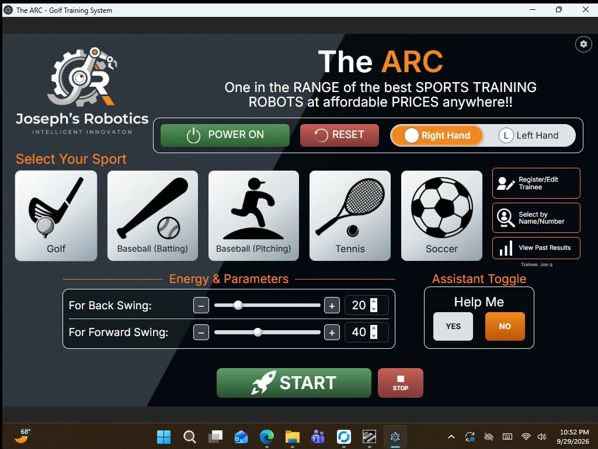
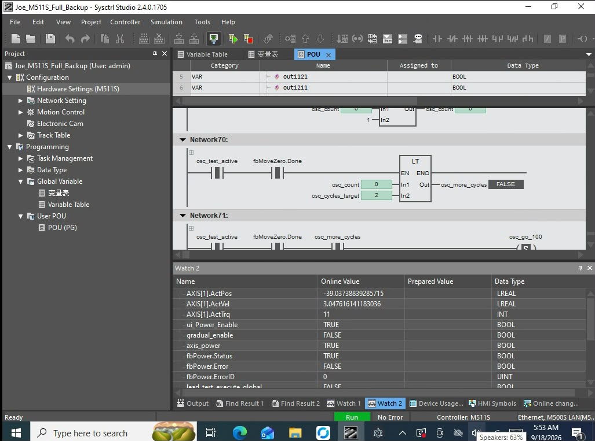
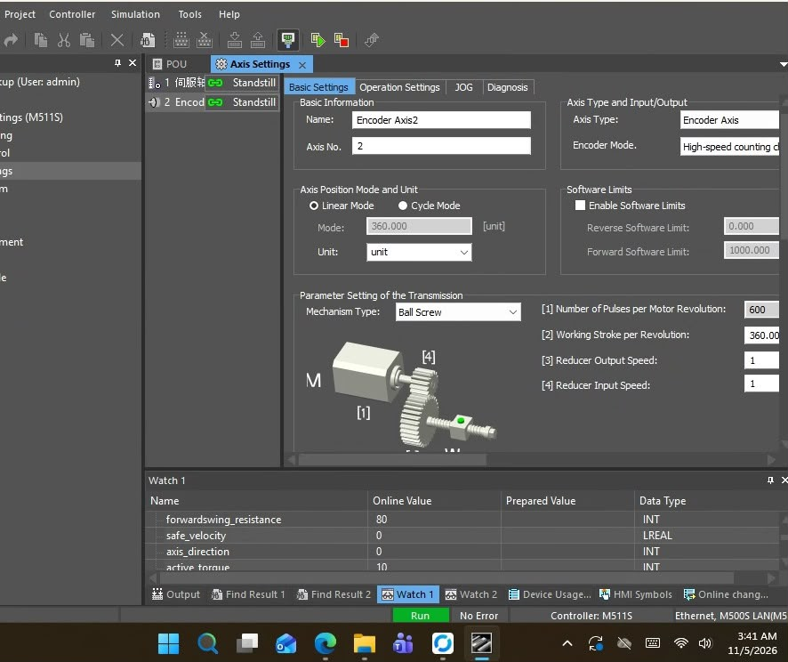
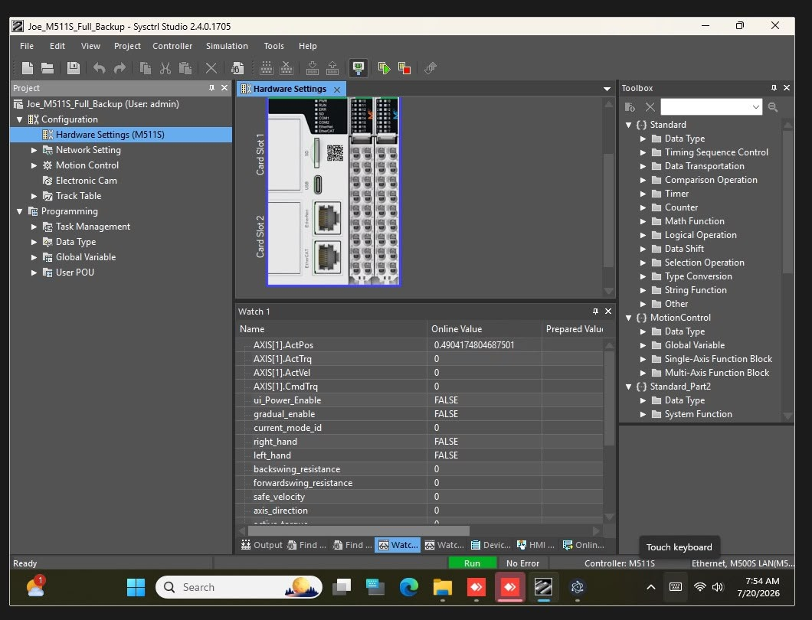
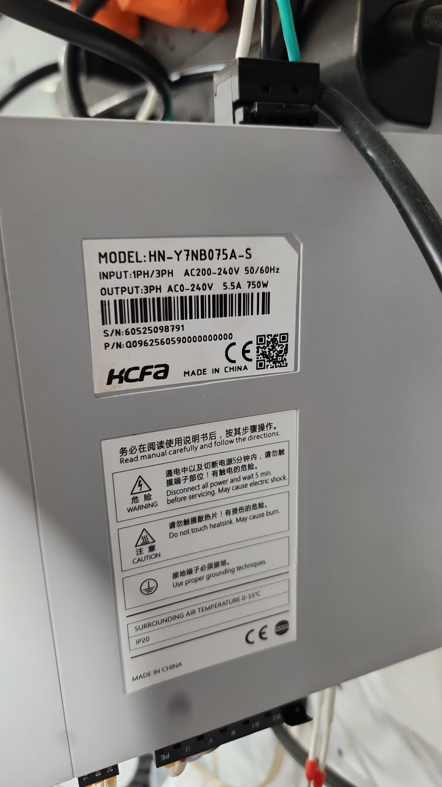
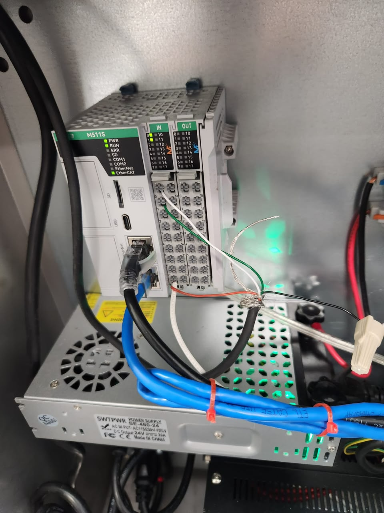
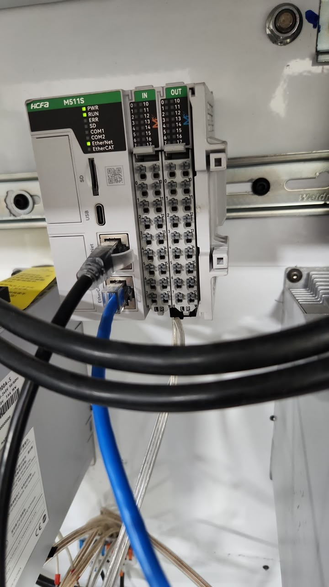
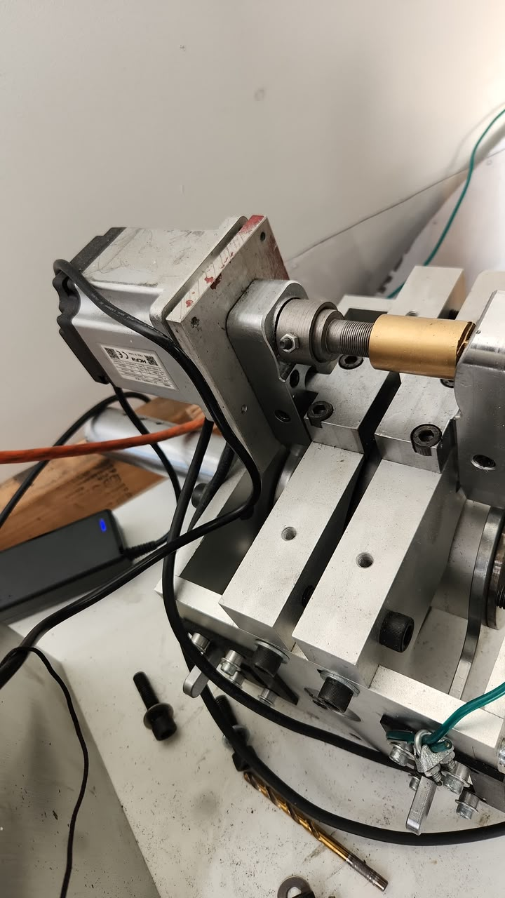
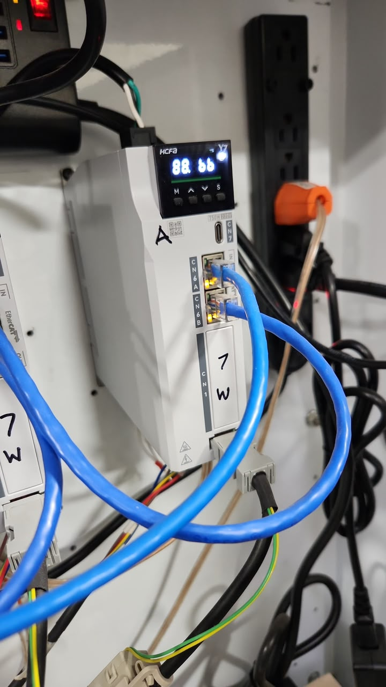
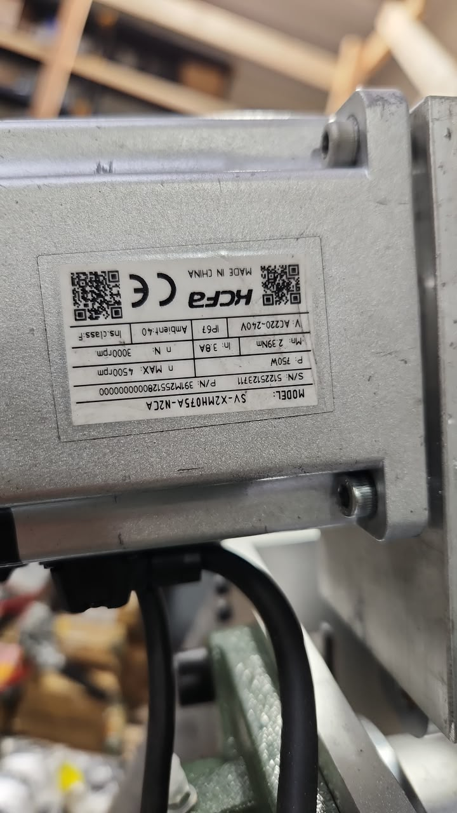

# PLC Automation — Hydraulic Resistance & Lead Screw Systems

**Two independent industrial automation projects** for a robotics-assisted sports/golf training platform, maintained in one repository. Each machine has its **own ARC user-interface project** and its **own PLC engineering project/backup**. The projects share an application context, but they are **not interchangeable configurations**.

This repository documents work involving **HCFA PLC ladder logic, motion control, motor drivers/servo drives, encoder/decoder feedback, industrial I/O, machine-level troubleshooting, and operator-facing software**.

**Developed for:** [MH-TechFusion](https://github.com/MH-TechFusion) — both the Hydraulic Resistance and Lead Screw automation projects.


## Contents

- [Project 1 — Hydraulic Resistance System](#project-1--hydraulic-resistance-system)
- [Project 2 — Lead Screw Motion System](#project-2--lead-screw-motion-system)
- [Repository structure](#repository-structure)
- [PLC ladder logic & industrial automation](#plc-ladder-logic--industrial-automation)
- [Media gallery](#media-gallery)
- [Engineering and commissioning notes](#engineering-and-commissioning-notes)

## The two projects at a glance

| | Project 1: Hydraulic Resistance | Project 2: Lead Screw |
|---|---|---|
| **Repository folder** | [`Final_hydraulic/`](Final_hydraulic/) | [`Lead_Screw/`](Lead_Screw/) |
| **Main mechanism** | Hydraulic resistance mechanism | Motor/drive-driven lead screw mechanism |
| **PLC platform** | HCFA PLC | HCFA PLC |
| **Engineering focus** | Resistance behavior and investigation of the reported **"hump" / non-smooth response** | Controlled linear motion and mechanical positioning |
| **Separate ARC UI** | [`Golf Training System_ARC_UI_ONLY`](Final_hydraulic/Golf%20Training%20System_ARC_UI_ONLY/) | [`Golf Training System_ARC_UI_ONLY`](Lead_Screw/Golf%20Training%20System_ARC_UI_ONLY/) |
| **Separate PLC project** | [`Joe_M511S_Full_Backup`](Final_hydraulic/Joe_M511S_Full_Backup/) | [`Joe_M511S_AutoFollow`](Lead_Screw/Joe_M511S_AutoFollow/) |

## Project 1 — Hydraulic Resistance System

**Folder:** [`Final_hydraulic/`](Final_hydraulic/)

This project relates to the **hydraulic resistance training setup**. Its controls and mechanical behavior are considered separately from those of the lead screw machine.

A central troubleshooting topic has been a reported **hump or uneven response** during operation. Useful engineering investigation areas include commanded versus observed behavior, transitions across the motion range, hydraulic resistance characteristics, and PLC/drive parameters. This is a *problem statement and investigation focus*, not a claim that the underlying cause has been confirmed or corrected.

**Project files:**

- **ARC interface:** [`Final_hydraulic/Golf Training System_ARC_UI_ONLY/`](Final_hydraulic/Golf%20Training%20System_ARC_UI_ONLY/) — the UI project kept with the hydraulic machine.
- **PLC engineering backup:** [`Final_hydraulic/Joe_M511S_Full_Backup/`](Final_hydraulic/Joe_M511S_Full_Backup/) — hydraulic-side PLC project/backup.

## Project 2 — Lead Screw Motion System

**Folder:** [`Lead_Screw/`](Lead_Screw/)

This project relates to a **separate lead screw-based electromechanical motion setup**. Its actuator behavior, positioning parameters, PLC programming, and UI project should be reviewed and tested independently of the hydraulic machine.

Engineering areas relevant to a lead screw system include motion sequencing, acceleration/deceleration, position limits, drive feedback, homing/reference behavior where applicable, and mechanical travel constraints. The actual implemented features must be verified in the source files and on the machine.

**Project files:**

- **ARC interface:** [`Lead_Screw/Golf Training System_ARC_UI_ONLY/`](Lead_Screw/Golf%20Training%20System_ARC_UI_ONLY/) — the UI project kept with the lead screw machine.
- **PLC engineering project:** [`Lead_Screw/Joe_M511S_AutoFollow/`](Lead_Screw/Joe_M511S_AutoFollow/) — lead screw-side PLC engineering files.

## Repository structure

Keep the following **three top-level folders** alongside this root-level `README.md`:

```text
PLC-Automation/
├── Final_hydraulic/                    # Project 1: hydraulic resistance
│   ├── Golf Training System_ARC_UI_ONLY/  # Hydraulic ARC UI
│   └── Joe_M511S_Full_Backup/            # Hydraulic PLC backup
│
├── Lead_Screw/                         # Project 2: lead screw
│   ├── Golf Training System_ARC_UI_ONLY/  # Lead screw ARC UI
│   └── Joe_M511S_AutoFollow/             # Lead screw PLC project
│
├── Media/                              # Shared documentation media
│   ├── 0.jpeg
│   ├── 1.jpeg
│   ├── 2.mp4
│   ├── 3.jpeg
│   ├── 4.jpeg
│   ├── 5.jpeg
│   ├── 6.jpeg
│   ├── 7.jpeg
│   ├── 8.jpeg
│   ├── 9.jpeg
│   └── 10.jpeg
│
└── README.md
```

> **Important:** Both projects intentionally contain a folder named `Golf Training System_ARC_UI_ONLY`. These are **different copies in different project folders**. Do not combine or overwrite them when publishing.

## PLC ladder logic & industrial automation

The engineering material covers the intersection of **HCFA PLC-based control** and **industrial motion systems**. The provided media includes screenshots of the PLC engineering environment, ladder logic, and motion/axis configuration, as well as actual control hardware. **HCFA is the PLC platform used for these setups**; exact controller, drive, and feedback-device models should be checked against the installed equipment and project files.

### Control concepts

- **Ladder logic (LD):** HCFA PLC programming for discrete control conditions, permissives, machine state transitions, and signal handling.
- **Motion control:** Drive/axis setup, motion commands, timing, and feedback relevant to each machine.
- **Motor drivers / servo drives:** Drive enable, direction, speed, torque, or position commands as supported by the connected motor driver and control mode.
- **Encoders, decoder signals & feedback:** Motor/axis position and speed feedback, pulse/encoder decoding where used, and related diagnostic inputs; confirm the installed feedback hardware and wiring.
- **HCFA PLC and drive integration:** Coordinating PLC ladder instructions, field I/O, motion drivers, status/fault indications, and the operator interface.
- **Industrial I/O:** Reading field signals and commanding outputs through PLC-connected hardware.
- **UI-to-controller integration:** Operator commands, parameter entry, machine state display, and diagnostics, subject to the interfaces implemented in each project.
- **Diagnostics and troubleshooting:** Comparing expected and observed behavior, using PLC monitoring and drive status to isolate problems.
- **Machine safety:** Emergency-stop design, hard limits, safe states, interlocks, and safe recovery must be verified independently for each physical installation.

**Conceptual control flow** (illustrative; not a verified wiring or software architecture diagram):

```text
Operator / ARC UI
       |
       v
PLC application (ladder logic, permissives, sequencing)
       |
       v
Motion / resistance-control hardware
       |
       v
Hydraulic mechanism OR lead screw mechanism
       |
       v
Feedback / machine status --> PLC diagnostics --> ARC UI
```

The hydraulic and lead screw setups can require **different controller parameters, control strategies, limits, and test procedures** even if both use related PLC/drive technologies.

## Media gallery

All media links below reference the **`Media/` folder in this repository**. Commit that folder together with `README.md` so GitHub can display the images.

### ARC UI, ladder logic & controller configuration

<div align="center">
  <table align="center">
    <thead>
      <tr><th align="center">ARC training user interface</th><th align="center">PLC ladder logic</th></tr>
    </thead>
    <tbody>
      <tr>
        <td align="center"></td>
        <td align="center"></td>
      </tr>
      <tr>
        <td align="center"><strong><code>3.jpeg</code> — Operator UI</strong></td>
        <td align="center"><strong><code>4.jpeg</code> — PLC ladder logic</strong></td>
      </tr>
    </tbody>
  </table>
</div>

<div align="center">
  <table align="center">
    <thead>
      <tr><th align="center">Motion / axis settings</th><th align="center">PLC hardware configuration and live monitoring</th></tr>
    </thead>
    <tbody>
      <tr>
        <td align="center"></td>
        <td align="center"></td>
      </tr>
      <tr>
        <td align="center"><strong><code>5.jpeg</code> — Motion configuration</strong></td>
        <td align="center"><strong><code>6.jpeg</code> — PLC hardware & monitoring</strong></td>
      </tr>
    </tbody>
  </table>
</div>

### Industrial automation hardware

<div align="center">
  <table align="center">
    <thead>
      <tr><th align="center">Motor / hardware identification</th><th align="center">PLC and I/O cabinet</th></tr>
    </thead>
    <tbody>
      <tr>
        <td align="center"></td>
        <td align="center"></td>
      </tr>
      <tr>
        <td align="center"><strong><code>0.jpeg</code> — Hardware identification</strong></td>
        <td align="center"><strong><code>1.jpeg</code> — PLC cabinet</strong></td>
      </tr>
    </tbody>
  </table>
</div>

<div align="center">
  <table align="center">
    <thead>
      <tr><th align="center">PLC hardware</th><th align="center">Mechanical drive assembly</th></tr>
    </thead>
    <tbody>
      <tr>
        <td align="center"></td>
        <td align="center"></td>
      </tr>
      <tr>
        <td align="center"><strong><code>7.jpeg</code> — Controller / I/O modules</strong></td>
        <td align="center"><strong><code>8.jpeg</code> — Actuation hardware</strong></td>
      </tr>
    </tbody>
  </table>
</div>

<div align="center">
  <table align="center">
    <thead>
      <tr><th align="center">Drive/controller wiring</th><th align="center">Motor nameplate</th></tr>
    </thead>
    <tbody>
      <tr>
        <td align="center"></td>
        <td align="center"></td>
      </tr>
      <tr>
        <td align="center"><strong><code>9.jpeg</code> — Drive hardware</strong></td>
        <td align="center"><strong><code>10.jpeg</code> — Motor identification</strong></td>
      </tr>
    </tbody>
  </table>
</div>

### Equipment demonstration video

<p align="center">
  <a href="Media/2.mp4"></a>
</p>

<p align="center">
  <strong><a href="Media/2.mp4">▶ Open equipment demonstration (<code>Media/2.mp4</code>)</a></strong> — short video of industrial control/drive equipment. The image above is a clickable thumbnail; GitHub's README rendering may open or download the MP4 rather than play it inline.
</p>

## Engineering and commissioning notes

1. **Open the correct project.** Hydraulic and lead screw software are maintained as distinct machine configurations.
2. **Use compatible engineering tools.** Verify the required PLC programming environment, project version, installed libraries, and matching controller hardware before opening or downloading a backup.
3. **Confirm configuration on site.** PLC IP settings, communication interfaces, I/O maps, drive parameters, axis assignments, limits, and device addresses must match the intended machine.
4. **Validate safety before movement.** Apply appropriate lockout/tagout and machine-safety procedures. Verify emergency stops, guards, limits, and safe states before commissioning or commanding motion.
5. **Record test results.** In particular, track the hydraulic hump investigation separately from lead screw motion testing; do not treat unverified results as completed fixes.
6. **Review before making the repository public.** PLC backups and client UI source can contain proprietary code, credentials, network details, or client-owned material. Publish only with appropriate authorization and remove sensitive information.

## Repository scope

This repository is organized to preserve the **source/backup separation, per-machine ARC UI, PLC ladder-logic context, and hardware reference media**. It is not a substitute for electrical drawings, validated machine-safety documentation, vendor manuals, or a site-specific commissioning procedure.

**License:** No open-source license is declared here. Rights to source code, customer materials, and vendor assets remain with their respective owners unless separately licensed.
